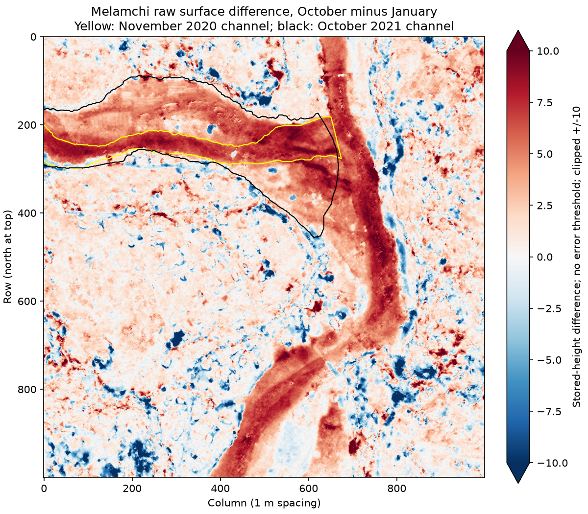

# Melamchi mapped-channel comparison and the failed stable-control assumption

2026-10-11. S447–S448. Research draft, no independent scientific archive review.

Four selected files from [Chen, West and project coauthors' HydroShare mapping dataset](https://www.hydroshare.org/resource/b6da096000284d5882d13b085b7669ac/) were downloaded through its public API, under the catalog's stated CC BY4.0 license. Byte counts and MD5 values matched the public file listing; SHA256 hashes are recorded in [S448](../data/sources.json). This checks delivered-file identity, not geological accuracy. Original KML files remain outside Git.

[Executed code](../analysis/melamchi_channel_comparison.py), [full results](../analysis/melamchi-channel-comparison-result.json), [raster baseline](MELAMCHI-RASTER-INSPECTION.md).

The parser recovered54 pre-channel polygons,34 post-channel polygons,131 post-cloud polygons and217 post-shadow polygons. Longitude/latitude rings were transformed from EPSG:4326 to the DSM's EPSG:32645. Polygon holes were retained; altitude coordinates were ignored. Masks used pixel centers, not every pixel touched by a boundary. The comparison retains the same1km window and raw October-minus-January differences.

## What the computation shows

| Disjoint category | Paired valid pixels | Median raw height difference | 5th–95th percentile |
| --- | ---: | ---: | --- |
| In both channel maps | 34,794 | 7.285 | 1.539–9.391 |
| In October channel only | 81,056 | 4.248 | 0.281–7.628 |
| In November channel only | 1,168 | 6.147 | 3.659–7.575 |
| Outside both maps | 881,123 | 0.991 | −4.500–6.872 |

These categories partition all998,141 paired valid pixels. October cloud/shadow polygons cover zero pixels in this selected window, so they exclude none. That says only what these masks contain; it does not establish that all imagery is clear or accurate. January masks are missing.



The figure was visually inspected. Strong positive changes occur within the mapped corridor, but a prominent channel-shaped corridor on the right lies outside both selected channel masks. The broader unmasked terrain also has mixed changes. **Outside both maps is therefore not a verified stable-ground sample.** Its median must not be subtracted as a measured vertical bias; its spread must not be adopted as a calibrated error estimate. Unmapped channels, vegetation, buildings, real terrain change and measurement errors remain possible contributors.

The November2020 channel map and January2021 baseline DSM differ in date. A polygon entering the later map does not by itself establish an erosion, deposition or inundation classification. These are raw surface distributions grouped by the authors' mapping; same-project maps and DSMs are dependent evidence. No statistical significance, independently measured sediment thickness, floodwater depth or sediment volume is assigned.

## Checks and next discriminator

Grid-transform equality, paired pixel count and the disjoint partition were checked. A synthetic square with a central hole returned the expected12 of16 included pixels; this checks ring parsing and rasterization, not field accuracy. The generated overlay was inspected for spatial plausibility. No independent geological review occurred.

Reproduce with the raster-inspection dependencies and the four file names/hash records in S448:

```text
python analysis/melamchi_channel_comparison.py --before Melamchi_DSM_P05_202101.tif --after Melamchi_DSM_P06_202110.tif --masks MASK_DIRECTORY --prior analysis/melamchi-raster-inspection-result.json --output masked-result.json --figure masked-comparison.png
```

The next discriminator is an independently justified stable-ground selection and the original uncertainty workbook, followed by classification of channels and deposits across the full comparison footprint. Preserve date mismatches, unmapped areas and registration limitations. A worldwide or historical reconstruction still needs separately dated, physically connected sites; this modern local comparison cannot supply those links.31case drafts/448sources; all twenty objectives remain active.
