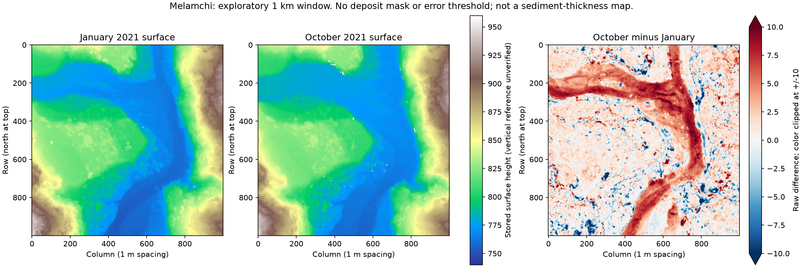

# Melamchi: acquired rasters and an executed local surface comparison

2026-10-11. S447 dataset, with S444 caption supplying an approximate location. No independent archive review.

The complete P05 January2021 and P06 October2021 GeoTIFFs were downloaded from [Chan-Mao Chen's OpenTopography dataset](https://portal.opentopography.org/dataspace/dataset?opentopoID=OTDS.102024.32645.1), attributed under its stated CC BY4.0 license. Files remain outside Git; byte counts and SHA256 hashes are in [S447's ledger](../data/sources.json). This is processing of the authors' data, not a new independent survey.

[Executed script](../analysis/melamchi_raster_inspection.py), [complete result](../analysis/melamchi-raster-inspection-result.json), and [updated acquisition ledger](../data/melamchi-dsm-acquisition.json).

## What was actually executed

Inspected both raster headers and a fixed1km square centered on the approximate coordinates in S444 Figure2's caption. Selection is retrospective, not a held-out prediction; no exact individual building match is claimed. The window was snapped to the source grid. Both files use1m pixels, EPSG:32645, float32 values, unit scaling, zero offsets and nodata−32768. Their origins differ by integer pixel counts. Exact window-transform equality was checked, so subtraction used matching pixels **without resampling**.

998,141 of1,000,000 pixels were valid in both rasters. After-minus-before quantiles are:

| Percentile | Raw stored-height difference |
| --- | ---: |
| 5 | −4.128 |
| 25 | −0.027 |
| 50 | 1.220 |
| 75 | 3.160 |
| 95 | 7.480 |

The TIFF band-height unit is unset, and the CRS supplies horizontal metre units without an independently verified vertical datum. These are raw differences; the table must not be read as measured deposit thickness or significant change. Extrema−25.375/+22.944 are likewise unclassified, not verified erosion/deposition depths.



The generated figure was visually inspected. A concentrated positive difference follows a channel-shaped corridor, with mixed changes elsewhere. This is a visual inference from the DSM comparison, not an authenticated river/deposit mask. Surface objects, vegetation, registration effects and intervening processes remain alternatives for individual pixels. Colors saturate at±10; the complete numerical extrema are retained in the result.

## Verification and remaining gates

A synthetic comparison checked a known7-unit surface difference on integer-shifted grids and the exclusion of a missing pixel; expected quantiles and paired count passed. Runtime versions are retained in the result. These checks concern arithmetic and indexing, not event attribution or vertical accuracy.

Reproduction requires Python with rasterio1.5.2, numpy2.5.4; plotting used matplotlib3.11.2 and GDAL3.12.2. Acquire the two URLs in the acquisition ledger and verify their hashes, then run:

```text
python analysis/melamchi_raster_inspection.py --before Melamchi_DSM_P05_202101.tif --after Melamchi_DSM_P06_202110.tif --output result.json --figure comparison.png
```

The current calculation is intentionally limited to a1km exploratory window. Stable controls, original masks, uncertainty workbook, height-unit/datum confirmation and registration transformations remain missing. No deposit volume was computed. Before quantitative interpretation, compare independent stable areas, classify the relevant surfaces and propagate spatially correlated error. January-to-October changes need separate evidence to attribute them specifically to June; aligned differences cannot recover removed overall translation/rotation.

This advances the local physical comparison from catalog metadata to acquired, hashed and processed observations. It does not connect the historical Reddit buildings to one event, reconstruct a global catastrophe, validate rewritten chronology or establish independent convergence.31case drafts/448sources; all twenty objectives remain active.
